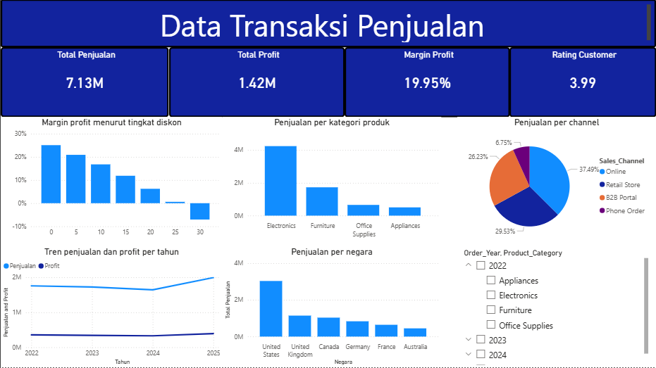

# 📊 Analisis Transaksi Penjualan 2022–2025

Proyek analisis end-to-end atas **18.000 transaksi penjualan** (Jan 2022 – Des 2025) dari 6 negara, 4 kategori produk, dan 4 channel penjualan. Alur kerja: **MySQL** (cleaning & EDA) → **Power BI** (dashboard).



**Tools:** MySQL · Power BI

## 📁 Struktur Repository

```
├── data/
│   ├── Sales_transactions_2022_2025.csv   # data mentah (18.045 baris)
│   └── datfinal.csv                       # data bersih (18.000 baris) -> sumber dashboard
├── sql/
│   ├── cleaning_data.sql                  # proses pembersihan data
│   └── eda.sql                            # analisis eksploratif
├── dashboard/
│   ├── penjualan.pbix
│   └── dashboard-powerbi.png
└── README.md
```

---

## 1. Pertanyaan Bisnis

1. Berapa total penjualan, profit, dan margin, dan bagaimana tren per tahun?
2. Kategori produk, channel, dan negara mana yang paling berkontribusi?
3. Apakah pemberian diskon benar-benar meningkatkan keuntungan?
4. Seberapa besar pendapatan hilang karena pembatalan dan retur, dan apa penyebabnya?
5. Apakah kode promo efektif?
6. Seperti apa profil dan loyalitas pelanggan?

---

## 2. Proses Data Cleaning (`cleaning_data.sql`)

Data mentah **18.045 baris, 36 kolom** → data bersih **18.000 baris** ditambah 6 kolom flag.

Semua perubahan dilakukan pada tabel salinan (`sales2` → `sales_cleaning` → `sales_cleaning2`), sehingga data mentah tetap utuh.

| Masalah ditemukan | Jumlah | Penanganan |
|---|---|---|
| Baris duplikat penuh | 45 | `ROW_NUMBER() OVER (PARTITION BY semua kolom)`, hapus `row_num > 1` |
| Penulisan tidak konsisten (`male`, `FEMALE`, `DebitCard`, `LOS ANGELES`, ` New York `, `NRW`, `completed`, `electronics`, dll.) | ratusan | `TRIM` + `CASE LOWER()` untuk menyeragamkan gender, status, metode bayar, kategori, kota, region |
| String kosong `''` | beberapa kolom | `NULLIF(kolom, '')` agar menjadi `NULL` sungguhan |
| `Product_Name` kosong | 144 | Diisi dari `Product_ID` yang sama (self-join) |
| Gender / metode bayar `NULL` | 162 / 147 | Diganti `'Unknown'` |
| `Quantity ≤ 0` | 8 | Dihitung ulang: `Sales_Amount / (Unit_Price × (1 − diskon))` |
| Umur tidak wajar (<16 atau >90) | 4 | Diubah menjadi `NULL` |
| Diskon tidak wajar (45%, 60%, 110%) | 3 | Dihitung ulang dari `Sales_Amount`, dibulatkan ke kelipatan 5 |
| `Profit ≠ Sales − Cost` | 110 | Diperbaiki: `Profit = Sales − Cost` |
| `Unit_Price` menyimpang >50% dari rata-rata produk | beberapa | Dikoreksi dari `Sales_Amount / (Qty × (1 − diskon))` |
| `Delivery_Days = 0` bukan pickup | – | Diubah menjadi `NULL` (pickup memang 0 hari) |
| `Customer_Rating = 0` | – | Diubah menjadi `NULL` (skala valid 1–5) |
| `Return_Flag = 'Yes'` tapi status bukan `Returned` | 276 | Tidak dihapus, hanya ditandai |

**Kolom flag pada tabel `sales_final` / `datfinal.csv`:**
`is_cancelled`, `is_returned_status`, `is_returned_flag`, `is_revenue_order`, `is_sales_mismatch`, `is_loss`

**Definisi penjualan bersih:** hanya transaksi berstatus *Completed*, *Shipped*, *Processing* (`is_revenue_order = 1`). Transaksi *Cancelled* dan *Returned* dikeluarkan. Di SQL ini diterapkan lewat view `v_sales`, dan di Power BI lewat **filter level halaman `is_revenue_order = 1`**, sehingga angka keduanya konsisten.

---

## 3. Dashboard Power BI

Dashboard satu halaman bersumber dari tabel `datfinal`, dengan **slicer Tahun → Kategori Produk** untuk eksplorasi interaktif.

| Komponen | Isi |
|---|---|
| 4 kartu KPI | Total Penjualan, Total Profit, Margin Profit, Rating Customer (rata-rata) |
| Kolom: **Margin profit menurut tingkat diskon** | Hubungan diskon dan margin |
| Garis: **Tren penjualan dan profit per tahun** | Perkembangan 2022–2025 |
| Kolom: **Penjualan per kategori produk** | Kontribusi tiap kategori |
| Kolom: **Penjualan per negara** | Kontribusi tiap negara |
| Pie: **Penjualan per channel** | Komposisi channel |
| Slicer | Order_Year dan Product_Category |

**Margin Profit** = Total Profit ÷ Total Penjualan.

### KPI Utama

| Metrik | Nilai |
|---|---|
| Total Penjualan | **7,13 juta** |
| Total Profit | **1,42 juta** |
| Margin Profit | **19,95%** |
| Rating Customer | **3,99 / 5** |
| Jumlah order / pelanggan | 12.915 / 4.696 |
| Rata-rata nilai order | 552 |

---

## 4. Insight dari Dashboard

### 4.1 Diskon menggerus margin (grafik margin menurut diskon)

| Diskon | Margin | % transaksi rugi | Rata-rata qty/transaksi |
|---|---|---|---|
| 0% | **25,1%** | 0% | 2,13 |
| 5% | 20,9% | 0% | 2,10 |
| 10% | 16,8% | 0,04% | 2,17 |
| 15% | 11,8% | 0,6% | 2,18 |
| 20% | 6,2% | **10,5%** | 2,16 |
| 25% | 0,6% | **28,7%** | 2,11 |
| 30% | **−7,0%** | 85,7% | 3,86 |

- Setiap kenaikan diskon 5% memangkas margin sekitar **4–5 poin persentase**.
- **Diskon tidak mendorong pembelian lebih banyak:** rata-rata qty per transaksi hampir sama (~2,1) di semua level diskon. Diskon hanya mengurangi margin tanpa menambah volume.
- Diskon ≥ 20% menghasilkan sekitar 91% dari seluruh transaksi rugi (178 dari 196).

### 4.2 Tren tahunan (grafik tren penjualan dan profit)

| Tahun | Penjualan | Profit | YoY | Margin |
|---|---|---|---|---|
| 2022 | 1,76 jt | 356 rb | – | 20,2% |
| 2023 | 1,73 jt | 343 rb | −1,8% | 19,9% |
| 2024 | 1,64 jt | 330 rb | −4,8% | 20,1% |
| 2025 | 2,00 jt | 393 rb | **+21,4%** | 19,7% |

- Penjualan **turun dua tahun berturut-turut** (2023–2024) lalu **rebound +21,4% di 2025**.
- Margin stabil di kisaran 19,7–20,2%, sehingga pertumbuhan 2025 datang dari volume, bukan dari perbaikan margin.

### 4.3 Kategori produk

| Kategori | Penjualan | Share | Margin |
|---|---|---|---|
| Electronics | 4,24 jt | **59,5%** | 19,3% |
| Furniture | 1,73 jt | 24,3% | 21,1% |
| Office Supplies | 0,65 jt | 9,2% | 19,4% |
| Appliances | 0,50 jt | 7,1% | **22,0%** |

- **Electronics mendominasi** hampir 60% penjualan, jadi bisnis sangat bergantung pada satu kategori.
- Appliances dan Furniture punya margin lebih tinggi meski kontribusi lebih kecil.
- Dua laptop (**ProBook 16** dan **AeroBook 14**) masing-masing menjual sekitar 1,2 juta dan menjadi penyumbang profit terbesar.

### 4.4 Negara

| Negara | Penjualan | Share | Margin |
|---|---|---|---|
| United States | 3,03 jt | **42,5%** | 19,9% |
| United Kingdom | 1,14 jt | 16,0% | 20,3% |
| Canada | 1,03 jt | 14,5% | 20,1% |
| Germany | 0,83 jt | 11,7% | 19,7% |
| France | 0,64 jt | 9,0% | 19,8% |
| Australia | 0,45 jt | 6,3% | 19,7% |

- **AS menyumbang 42,5%** penjualan, hampir 3× Inggris. Margin merata (~20%) di semua negara, sehingga perbedaannya ada di volume, bukan efisiensi.

### 4.5 Channel (pie chart)

| Channel | Share |
|---|---|
| Online | **37,49%** |
| Retail Store | 29,53% |
| B2B Portal | 26,23% |
| Phone Order | 6,75% |

- Online adalah channel terbesar, namun toko fisik dan B2B Portal masih menyumbang lebih dari separuh. Margin hampir sama di semua channel (19,8–20,1%).
- Phone Order kecil (6,75%) dan layak dievaluasi biaya vs manfaatnya.

---

## 5. Insight Tambahan dari Analisis SQL (`eda.sql`)

Hal berikut tidak ditampilkan di dashboard tetapi ditemukan dari EDA.

**Kebocoran pendapatan.** Dari penjualan kotor 8,23 juta, sekitar **1,11 juta (13,4%)** hilang karena pembatalan (393 rb) dan retur (712 rb).

**Musiman.** November (806 rb) dan Desember (798 rb) adalah puncak, sedangkan Januari terendah (439 rb), selisih sekitar 1,8×. Hari kerja (~2.400 transaksi/hari) jauh lebih ramai daripada akhir pekan (~1.690). Jam tersibuk **13.00–17.00**.

**Retur.** Return rate sekitar 8,6–9,6% di semua kategori (tertinggi Appliances 9,6%). Penyebab tersebar merata: Late Delivery (286), Wrong Item (271), Damaged (269), Other (265), Defective (258), Changed Mind (248). Tiga penyebab pertama (±826 retur) terkait operasional dan bisa dicegah. Metode pengiriman hampir tidak memengaruhi rating (3,97–4,03) maupun return rate.

**Kode promo.** Semua kode promo memiliki margin (19,2–20,9%) dan rata-rata nilai transaksi ($413–$491) yang setara dengan transaksi tanpa promo (20,0%, $460). **Tidak ada bukti bahwa promo meningkatkan nilai transaksi.** Catatan: tanpa data pembanding sebelum/sesudah promo, efek terhadap jumlah transaksi belum bisa disimpulkan.

**Pelanggan.** 71,6% pelanggan membeli lebih dari sekali. Top 10% pelanggan menyumbang sekitar 41% penjualan. Segmen Consumer terbesar (44,3%); **Corporate memiliki margin terendah (18,4%)** versus segmen lain 20–21%. Kelompok umur 35–44 tahun terbesar (2,55 jt), diikuti 25–34 (1,79 jt).

**Margin produk.** Terendah: Copy Paper Box (12,2%), Printer Plus (13,9%), EdgeTab 11 Tablet (14,8%), Meeting Table (15,5%). Tertinggi: NoiseCancel Headset (26,1%), Filing Cabinet (25,0%).

---

## 6. Rekomendasi

1. **Batasi diskon maksimum 15%.** Di atas itu margin tinggal satu digit atau negatif, dan volume tidak naik. Wajibkan persetujuan khusus untuk diskon ≥ 20%.
2. **Evaluasi program promo.** Tidak ada kode promo yang terbukti lebih baik daripada harga normal. Jalankan uji A/B sebelum kampanye berikutnya.
3. **Siapkan stok dan kapasitas untuk Q4 (Nov–Des)**, terutama Electronics, dan buat kampanye non-diskon di Januari–Februari yang lemah.
4. **Kurangi ketergantungan pada Electronics dan pasar AS.** Dorong Furniture dan Appliances (margin lebih tinggi) lewat cross-sell bersama laptop, serta kembangkan UK dan Kanada.
5. **Perbaiki margin produk besar tapi tipis** (AeroBook 14, EdgeTab 11, Meeting Table) lewat negosiasi supplier atau penyesuaian harga.
6. **Tekan retur dari sisi operasional.** Fokus pada keterlambatan pengiriman, salah barang, dan barang rusak: perbaiki QC gudang, pengemasan, dan SLA kurir.
7. **Jaga pelanggan bernilai tinggi.** Buat program loyalitas untuk top 10% pelanggan dan tinjau harga kontrak segmen Corporate.

---

## 7. Catatan dan Keterbatasan

- Data tidak memuat biaya operasional, sehingga *profit* adalah laba kotor (Sales − Cost).
- 276 transaksi memiliki `Return_Flag = Yes` namun status bukan `Returned`; dibiarkan dan ditandai untuk klarifikasi.
- 65 baris (0,34% penjualan) masih tidak cocok dengan rumus Qty × Harga × (1 − diskon) dan ditandai `is_sales_mismatch = 1`.
- Rating kosong (hasil cleaning) tidak dihitung dalam rata-rata rating.
- Penjualan bersih mengasumsikan transaksi *Cancelled* dan *Returned* bukan pendapatan.
